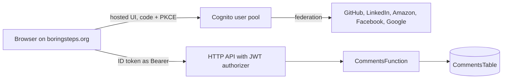

# Comments back-end

The serverless back-end for reader comments on Boring steps posts. It is an
AWS SAM application: Amazon Cognito for social sign-in, an HTTP API with a
Cognito JWT authorizer, one Python 3.12 Lambda, and one DynamoDB table. The
widget that talks to it is `documentation/.vitepress/theme/PageComments.vue`.

## Architecture



| Route | Authorization | Purpose |
| --- | --- | --- |
| `GET /posts/{slug}/comments` | public | Approved comments of a post, oldest first |
| `POST /posts/{slug}/comments` | signed in | New comment or reply (`{"text", "parent_id"?}`) |
| `PATCH /posts/{slug}/comments/{id}` | `moderators` group | Set `status` to `approved`, `pending` or `hidden` |
| `GET /posts/{slug}/moderation` | `moderators` group | Every comment of a post, with its status |

- One Lambda (`src/app.py`) routes on the HTTP API route key; `src/rules.py`
  holds validation and moderation rules, `src/store.py` the DynamoDB access.
- The table is keyed by post slug (`pk`) and `created_at#comment_id` (`sk`).
  Reading a thread is one `Query`; there are no scans. Write-limit counters
  live in the same table under `user#<sub>` and expire through TTL on
  `expires_at`.
- Stored comments hold the Cognito `sub`, a display name, the text, the time,
  the status and an optional `parent_id`. No email, IP or user agent.
- The widget redirects back to `/comments-callback.html`, a static page that
  returns the reader to the post they came from.
- Each identity provider is optional: an empty client id parameter leaves it
  out of the stack.

## Register the OAuth apps

Every provider redirects to the Cognito hosted UI, not to the site. After a
first deploy, read the `IdpResponseUrl` stack output, which has the form:

```text
https://<CognitoDomain>/oauth2/idpresponse
```

Register it as the redirect (callback) URI in each provider app:

| Provider | Where | Notes |
| --- | --- | --- |
| Google | Google Cloud console, OAuth client of type "Web application" | Authorized redirect URI; add `amazoncognito.com` to authorized domains |
| Facebook | Meta for Developers, Facebook Login | Valid OAuth redirect URI; request `public_profile` and `email` |
| Amazon | Login with Amazon, security profile, web settings | Allowed return URL; allowed origin `https://<CognitoDomain>` |
| LinkedIn | LinkedIn Developers, app, Auth tab | Add the "Sign In with LinkedIn using OpenID Connect" product |
| GitHub | GitHub, Settings, Developer settings, OAuth Apps | Callback URL is the Cognito redirect URI (see the wrapper below) |

Keep each client id for the deploy parameters. Each client secret goes to AWS
Secrets Manager, never to the repository.

## Store the client secrets

The template reads each secret at deploy time through a dynamic reference to
`<SecretsPrefix>/<provider>`, key `client_secret`. With the default prefix,
the secret names are `boringsteps/comments/google`, `.../facebook`,
`.../amazon`, `.../linkedin` and `.../github`:

```shell
$ aws secretsmanager create-secret --name boringsteps/comments/<provider> --secret-string '{"client_secret":"<secret>"}'
```

Create only the secrets of the providers you enable; a provider with an empty
client id is never resolved.

## GitHub through the OpenID wrapper

GitHub speaks OAuth 2.0, not OpenID Connect, so it goes through
[github-cognito-openid-wrapper](https://github.com/TimothyJones/github-cognito-openid-wrapper)
(BSD-3-Clause), pinned at `v2.0.0`. Deploy it separately with its own SAM
template (`template.yml`), following its README, with the GitHub OAuth app
client id and secret and the Cognito redirect URI. It is not part of this
stack.

Pass its issuer URL (`https://<api>/<stage>`, no trailing slash) as
`GitHubIssuerUrl`, together with `GitHubClientId`. Cognito cannot discover the
wrapper's endpoints, so the template sets `/authorize`, `/token`, `/userinfo`
and `/.well-known/jwks.json` explicitly.

## Deploy

```shell
$ make comments-test
$ make comments-deploy
```

The first `make comments-deploy` runs `sam deploy --guided` and writes
`comments/samconfig.toml` (gitignored); later runs reuse it.

| Parameter | Default | Meaning |
| --- | --- | --- |
| `SiteOrigin` | `https://boringsteps.org` | Site origin for CORS and the OAuth callback and sign-out URLs |
| `AllowLocalOrigins` | `false` | `true` also allows `http://localhost:5173` and `:4173` (`make serve`, `make preview`); keep `false` in production |
| `CognitoDomainPrefix` | `boringsteps-comments` | Prefix of the hosted UI domain |
| `GoogleClientId` | empty | Google client id; empty disables Google |
| `FacebookClientId` | empty | Facebook app id; empty disables Facebook |
| `AmazonClientId` | empty | Login with Amazon client id; empty disables Amazon |
| `LinkedInClientId` | empty | LinkedIn client id; empty disables LinkedIn |
| `GitHubClientId` | empty | GitHub OAuth app client id; empty disables GitHub |
| `GitHubIssuerUrl` | empty | Issuer URL of the wrapper; empty disables GitHub |
| `SecretsPrefix` | `boringsteps/comments` | Secrets Manager prefix of the client secrets |
| `RequireApproval` | `false` | `true` makes new reader comments `pending` |
| `ModerationKeywords` | empty | Comma-separated keywords that send a comment to `pending` |
| `MaxCommentLength` | `2000` | Maximum comment length in characters |
| `WriteLimitCount` | `5` | Comments allowed per user within one window |
| `WriteLimitWindowSeconds` | `600` | Length of the write window in seconds |

| Output | Use |
| --- | --- |
| `ApiUrl` | `VITE_COMMENTS_API_URL` |
| `CognitoDomain` | `VITE_COMMENTS_COGNITO_DOMAIN` |
| `UserPoolClientId` | `VITE_COMMENTS_CLIENT_ID` |
| `UserPoolId` | Moderator and data-deletion commands |
| `IdpResponseUrl` | Redirect URI of every provider app |

The table and the user pool have a `Retain` deletion policy, so deleting the
stack keeps comments and accounts.

## Add a moderator

The reader signs in once, so Cognito creates the federated user. Then find the
username (for example `Google_<id>`) and add it to the `moderators` group:

```shell
$ aws cognito-idp list-users --user-pool-id <UserPoolId> --filter 'name = "<display name>"'
$ aws cognito-idp admin-add-user-to-group --user-pool-id <UserPoolId> --username <username> --group-name moderators
```

The group membership reaches the widget in the next ID token, so the moderator
signs out and in again.

## Build the site with comments

The widget is inert until the three build-time variables are set. Take them
from the stack outputs:

```shell
$ export VITE_COMMENTS_API_URL=<ApiUrl>
$ export VITE_COMMENTS_COGNITO_DOMAIN=<CognitoDomain>
$ export VITE_COMMENTS_CLIENT_ID=<UserPoolClientId>
$ make build
$ make preview
```

Signing in from `make serve` or `make preview` needs a stack deployed with
`AllowLocalOrigins=true`, because the production stack only accepts
`SiteOrigin` as a CORS origin and OAuth redirect. Use a separate test stack
for that rather than opening the production user pool to localhost.

The values are public (the client has no secret) and go to the JavaScript
bundle only, never the static HTML. `.github/workflows/deploy.yml` does not set
them yet, so production builds stay without comments until the workflow gets
these variables.

## Delete a reader's data

On request, find the reader's Cognito `sub` and username, delete their
comments post by post, then delete the Cognito user:

```shell
$ aws cognito-idp list-users --user-pool-id <UserPoolId> --filter 'name = "<display name>"'
$ aws dynamodb query --table-name <CommentsTable> --key-condition-expression 'pk = :slug' --filter-expression 'author_sub = :sub' --expression-attribute-values '{":slug":{"S":"<slug>"},":sub":{"S":"<sub>"}}' --projection-expression 'pk, sk'
$ aws dynamodb delete-item --table-name <CommentsTable> --key '{"pk":{"S":"<slug>"},"sk":{"S":"<sk>"}}'
$ aws cognito-idp admin-delete-user --user-pool-id <UserPoolId> --username <username>
```

Replies to a deleted comment no longer have a parent and the widget drops them,
so delete or keep them deliberately. Write-limit counters expire on their own.

## Moderation rules

The rules are inspired by [Artalk](https://github.com/ArtalkJS/Artalk) (MIT);
no Artalk code is ported.

| Topic | Artalk behaviour | Adopted rule |
| --- | --- | --- |
| Statuses | Booleans `IsPending`, `IsCollapsed`, `IsPinned` | One `status` field: `approved`, `pending` or `hidden` (`hidden` stands in for collapsed). Pinning is deferred. |
| Default approval | `moderator.pending_default: false`. Admins never go to pending. | New comments are `approved`. Template parameter `RequireApproval` (`false`/`true`, default `false`) makes them `pending`. A moderator's own comment is always `approved`. |
| Keyword filter | Off by default. Each keyword is a case-sensitive substring match. Mode is either block (comment goes to pending) or replace (keyword masked with `x`). Admins skip the check. | Pending mode only, no masking. The match is a case-insensitive substring match (`casefold`). Keywords come from template parameter `ModerationKeywords` (comma-separated, default empty), passed in env `MODERATION_KEYWORDS`, never hard-coded. Moderators skip the filter. |
| Nesting | Front-end `nestMax: 2`. The server checks that the parent exists, has the same `page_key`, and `IsAllowReply` (parent is not pending and not collapsed). | Maximum depth is one reply level. The parent must exist in the same slug partition (a parent from another slug is "not found"), must have no `parent_id`, and must be `approved`. |
| Write limit | Captcha `action_limit: 3` within `action_reset: 60` s. Admins are exempt. | Per-user fixed window: `WriteLimitCount` = 5 comments per `WriteLimitWindowSeconds` = 600, with a 429 above that. Moderators are NOT exempt, which caps the damage from a stolen token. Counter items carry a TTL. |
| Max length | No content limit (only `http.body_limit: 100` MB) | Text is stripped and must be 1 to `MaxCommentLength` = 2000 characters, otherwise 400. Display name is cut to 80 characters. |
| Identity stored | Name, email, link, IP, UA | Only `author_sub` (JWT `sub`) and `author_name` (`name`, then `preferred_username`, then `"Reader"`; any value containing `@` is replaced by `"Reader"`). No email, IP or UA. |
| Moderation UI | Admin sidebar | Inline Approve, Hide and Set pending buttons for members of the `moderators` group, backed by `GET /posts/{slug}/moderation`. |

## Development

```shell
$ make comments-test
$ make comments-build
$ cd comments && sam validate --lint --region eu-west-3
```

`make comments-test` runs pytest with moto (no AWS calls) and ruff through
`uv`; development dependencies are pinned in `pyproject.toml` and `uv.lock`.
The Lambda uses only the standard library and the boto3 shipped with the
runtime, so `src/requirements.txt` is empty.
