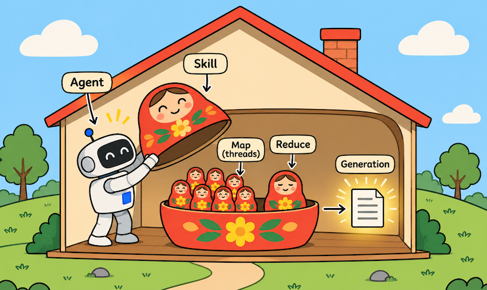
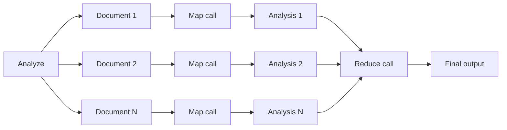
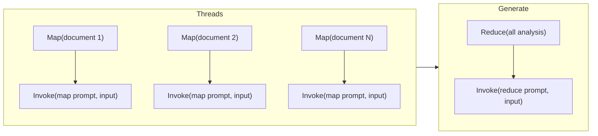

# MapReduce in an agent skill

Sooner or later, you will hit the end of the context window. Ask an agent to read the meeting notes of a quarter, the tickets of a release, or every page of a policy folder. The agent can do it a bit, then admit this is too much. The usual workarounds each give something up. Truncation drops information on purpose. Retrieval reads a sample, which is fine for a question and wrong for a digest that must cover everything. Pushing back on both sampling and truncating, we opted for the boring path to find a solution.



The obvious approach is to fragment the corpus under analysis. Do not ask one LLM call to read everything. Give each input item its own call, with a fresh context window and a small, bounded result. Then give the small results to one last call that writes the final answer. This is the famous [MapReduce](https://en.wikipedia.org/wiki/MapReduce) pattern, but applied inside an agentic skill. It has been extensively discussed in the agentic community. For example, it is named [Fan out and synthesize](https://docs.langchain.com/oss/python/deepagents/dynamic-subagents#fan-out-and-synthesize) in the LangChain documentation, and Devin makes it dependent on [sharding before MapReduce](https://devin.ai/blog/agentic-map-reduce).

In this post we want to democratize agentic MapReduce. This is a very accessible programming pattern, independent of any platform or framework. A working implementation in one single Python module of 300 lines is provided. We show every moving part, and we demonstrate what it can do and what it cannot do. The end-to-end implementation has it all: one skill, one Python script, and an inference provider. It provides enough detail so that you can borrow or adapt the implementation to your own requirements. Finally, we package the skill once and install it twice: in the IDE with Claude Code, and in an autonomous agent with Strands Agents.

## Map, then reduce

The map stage turns each input into a short output. Typically: at most ten bullet points, a few hundred tokens, one well-structured JSON snippet. Each call sees exactly one document, so its context is never crowded, and a cheap, fast model is enough. The input tokens can be in the thousands, and the output tokens in the hundreds. There are as many invocations as items in the entire corpus. Mapping costs grow linearly with the number of items. We commonly use [Claude Haiku](https://www.anthropic.com/claude/haiku) here. Other models could be considered for input mapping, e.g., Qwen3 4B / 8B Instruct, Llama 3.1 8B Instruct, Gemma 3 4B / 12B Instruct, GLM / DeepSeek small “Flash” variants. This list is not exhaustive, and you really have many options to consider. You could even use [Jev](https://en.wikipedia.org/wiki/Jev_(AI_model)) or similar, when the output consists essentially of individual decisions made on each input.

The reduce stage reads all the outputs at once. Because each output is small, a hundred documents become a reduce input of a few tens of thousands of tokens, which a stronger model handles comfortably. We got good results with [Claude Sonnet](https://www.anthropic.com/claude/sonnet), yet other options could have been considered, e.g., DeepSeek-V4-Pro, Kimi K3, or GLM-5.2. Again, consider the models that are making sense for your specific environment.



The shape has two useful properties. The mapping work per call stays constant however many documents there are. And the map calls do not depend on each other, so they can all run at the same time.

## The boundaries of MapReduce in a skill

The script executes either on the same infrastructure as the agent itself, or in a separate sandbox. In both cases, the computing power and the memory devoted to the script are limited. No magic here. The MapReduce pattern does not increase resources, but it allows three breakthroughs:

1. __Decouple the context window from the number of items under analysis__. With 100 items, the model used for the map operation will be invoked 100 times. With 1,000 items, the model will be invoked 1,000 times. You can tailor the context window of the model to the maximum size of one individual item, instead of the total size of all items. This is much simpler to achieve, yet the total number of tokens processed grows linearly with the number of items. Pay attention to that and tune the model used for the map operations.

2. __Parallelize the work to accelerate the analysis__. When processing a batch of items, the script is waiting most of the time for the model's responses. This is inherent to operations performed over the network. The pool of threads allows for parallel processing, meaning a more efficient way to use local computing resources. The limitation is the number of threads that can be accepted by the underlying infrastructure.

3. __Adjust final generation to limited context__. If thousands of items each result in hundreds of bytes or less, then the total input for the final generation is easily limited to some MB. This is rather an easy task for modern models. Still, tune the prompt and the model to your exact needs, with the objective to limit expenses.

## The orchestrating code

All we need is a single Python script that we called `map_reduce.py`, placed in the folder `scripts/` of the packaged skill.



We have one function to support all LLM invocations. Having a single seam is what makes the rest testable: an offline stub with the same signature replaces it in `--dry-run` mode. We are using [Amazon Bedrock](https://aws.amazon.com/bedrock/) as a serverless inference provider, using the Bedrock [Converse API](https://docs.aws.amazon.com/bedrock/latest/userguide/conversation-inference.html). Yet the code below is pretty generic, so feel free to adapt it to your own use case. The most important thing is that you get one function to invoke LLM generation, passing a system prompt, providing input and parameters, and returning the generated output along with some meta-information. 

<<< @/../skills/map-reduce/scripts/map_reduce.py#invoke{python}

The map stage submits one call per file to a thread pool. We commonly use up to 8 mapping threads in parallel, yet you should tune this to your needs. Maybe 32 threads could work better for you, or 4. The sweet spot can be found with some tests, e.g., 4, 8, 16, 24, 32. Grow the pool progressively, but stop when a larger pool does not translate into a performance gain. Each mapping call clips its input to a character cap and gets its own token cap on the output. A failed call is recorded and does not stop the others. Results are sorted by source at the end, because completion order varies from run to run and the reduce should not.

<<< @/../skills/map-reduce/scripts/map_reduce.py#map{python}

The reduce stage is one LLM call. It concatenates the notes under a `## source:` heading each, so the final output can cite where every finding came from.

<<< @/../skills/map-reduce/scripts/map_reduce.py#reduce{python}

The prompts live next to the script, in `prompts/map.md` and `prompts/reduce.md`. They are the part you are expected to change: what the map extracts, and what the reduce writes. The defaults produce a cited brief with an "open questions" section, which is a reasonable starting point for notes and reports.

## Threads versus processes

We deliberately selected [Python threads](https://realpython.com/intro-to-python-threading/) for the orchestration of mappings. Threads are suited when I/O is the most important performance factor. A remote LLM invocation spends almost all its time waiting on the network, so the Python global interpreter lock is not the bottleneck, and threads are enough. In addition, threads can share memory resources, such as one `bedrock-runtime` client, which is thread-safe and keeps a connection pool sized to the worker count, with adaptive retries for throttling. 

Processes are also available from the standard Python library. You may have to prioritize processes over threads if you invoke heavy models locally, and if you observe that the computing power is the most limiting factor. For example, you could use processes instead of threads if each map activity parses a large PDF file involving complex text recognition. Check [threading and processing](https://python-academy.org/en/guide/threading-and-multiprocessing) from the Python Academy to learn more on these models and on related data structures (queues, locks, etc.).

## One command, no environment to manage

The Python script declares its own dependencies at the top, using inline script metadata ([PEP 723](https://peps.python.org/pep-0723/)). In our case, we rely on Python and on the AWS SDK for remote access to Bedrock. Change these to your specific architecture.

```python
# /// script
# requires-python = ">=3.12"
# dependencies = ["boto3"]
# ///
```

With that header, `uv run` builds a cached, isolated environment on first use and reuses it afterwards. There is no virtual environment to create and no requirements file to install. Note that `uvx` would not do here: it runs commands from published packages, and it cannot run a local script file.

```shell
$ uv run skills/map-reduce/scripts/map_reduce.py notes/ --output brief.md
```

This command installs the dependencies of the script, then it executes the script. The folder `notes/` contains the corpus of files under analysis. The `--output` parameter says where to store the result. Note also that the script is run using ambient AWS credentials, meaning IAM permissions given to the agentic runtime itself. You can adapt this pattern to your inference provider. The only hard dependency is the primitive `uv` itself. But nowadays, this is more and more commonly installed in agentic environments.

Of course, you can execute the command on your own, for example to test it on a given set of documents. In our case, there is also a `--dry-run` mode that invokes a deterministic stub instead of Bedrock. This supports non-regression tests at no cost.

```shell
$ uv run skills/map-reduce/scripts/map_reduce.py --dry-run notes/
```

## Configuration lives in the skill

An agent reading the skill needs to know which knobs exist without reading the code. So every setting is an environment variable with a default, and the table lives in the skill's own `SKILL.md`. In our specific context, where inferences are submitted to Amazon Bedrock:

| Variable | Default | Purpose |
| --- | --- | --- |
| `MAP_MODEL` | `eu.anthropic.claude-haiku-4-5-20251001-v1:0` | Map model, one call per input (cheap tier) |
| `REDUCE_MODEL` | `eu.anthropic.claude-sonnet-4-5-20250929-v1:0` | Reduce model, one call (stronger tier) |
| `REGION` | `eu-west-3` | AWS region of the Bedrock client |
| `WORKERS` | `8` | Size of the threading pool |
| `MAX_INPUT_CHARS` | `24000` | Characters of each input sent to the map call |
| `MAP_MAX_TOKENS` | `1024` | Token cap on each map result |
| `REDUCE_MAX_TOKENS` | `4096` | Token cap on the final output |
| `GLOB` | `**/*.md` | File pattern when the target is a folder |
| `MAP_PROMPT` | `prompts/map.md` | System prompt for the map stage |
| `REDUCE_PROMPT` | `prompts/reduce.md` | System prompt for the reduce stage |
| `BACKEND` | `bedrock` | `bedrock`, or `echo` for the offline stub |

The defaults pair a cheap model for the many map calls with a stronger one for the single reduce call, which is where most of the reasoning happens. The script never holds credentials; it uses whatever the default AWS credential chain provides.

The script reads its settings in one place, so the table and the code are easy to compare:

<<< @/../skills/map-reduce/scripts/map_reduce.py#config{python}

## Package once, install twice

A skill is a folder. Ours follows the [Agent Skills](https://agentskills.io/specification) format, an open format that both Claude and [Strands Agents](https://strandsagents.com/) can read. Therefore, there is nothing to build and nothing to convert: the package is the folder itself.

```text
map-reduce/
├── SKILL.md            # name, description, instructions, configuration table
├── scripts/
│   └── map_reduce.py   # the orchestrator, with its dependencies inline
├── prompts/
│   ├── map.md
│   └── reduce.md
└── fixtures/           # a few notes to test offline
```

Before distributing the folder, we check three things:

1. __The description carries the trigger.__ At start-up, an agent reads only the `name` and the `description` of each skill. It loads the rest of `SKILL.md` when the description matches the task at hand. For this reason, our description lists the plain words that people actually use: summarize a folder, digest many documents, too many files for the context.
2. __Paths are relative to the skill folder.__ The same folder is copied into `.claude/skills/` in one case, and next to an application in the other case. Hence the need to avoid any path that starts from the root of a repository. `SKILL.md` names the script relative to its own folder, and the script finds its prompts relative to itself.
3. __The host provides three things, and only three.__ A shell tool to run the command, `uv` on the path, and AWS credentials that are allowed to invoke the two models in the region. The skill brings everything else.

The third point excludes one route: uploading the skill as a zip file to the Claude apps. Skills uploaded there run in a hosted sandbox, which usually has neither your AWS credentials nor a route to your Bedrock endpoint. In other terms, keep this skill where the credentials are. Let us look at the two routes that we use every day: Claude Code in the IDE, with a human in the loop, and a Strands agent that runs on its own.

### In the IDE, with Claude Code

[Claude Code](https://code.claude.com/docs/en/skills) looks for skills in two places on your machine. A project skill is placed in `.claude/skills/<name>/` in the repository, and comes with every clone. A personal skill is placed in `~/.claude/skills/<name>/`, and is available in all your projects on this machine. The VS Code and JetBrains extensions run Claude Code, so they read the same folders.

In the context of a team, copy the folder into the repository and commit it:

```shell
$ git clone --depth 1 https://github.com/bernard357/boringsteps.git /tmp/boringsteps
$ mkdir -p .claude/skills
$ cp -R /tmp/boringsteps/skills/map-reduce .claude/skills/
$ git add .claude/skills/map-reduce
```

In the context of your own workstation, keep a clone and link the folder. As a result, a `git pull` is enough to update the skill:

```shell
$ git clone https://github.com/bernard357/boringsteps.git ~/src/boringsteps
$ mkdir -p ~/.claude/skills
$ ln -s ~/src/boringsteps/skills/map-reduce ~/.claude/skills/map-reduce
```

There is no need to restart: Claude Code detects a new skill in the current session. Type `/` in the prompt box, and you should see `/map-reduce` in the list. From there, you have two ways to use it. You can ask in plain words, e.g., "digest the meeting notes in `notes/` into a brief with open questions", and Claude matches the request with the description. Or you can name the skill explicitly with `/map-reduce notes/`. In both cases, Claude reads the instructions, runs the offline check first, then the real run, and finally reads `brief.md` to discuss it with you. Note that Claude Code expands `${CLAUDE_SKILL_DIR}` in `SKILL.md` to the folder of the skill. As a consequence, the command is correct whether the skill is installed per project or per user.

By default, Claude asks for your approval before each shell command. In the IDE, this is a useful check: you see the exact command, the model identifiers and the target folder before any token is spent. If the same command comes back every day, then allow it once for the project, in `.claude/settings.json`:

```json
{
  "permissions": {
    "allow": ["Bash(uv run .claude/skills/map-reduce/scripts/map_reduce.py *)"]
  }
}
```

The AWS profile is personal, so it does not belong to the repository. Export `AWS_PROFILE` before you launch your IDE, or put it in `.claude/settings.local.json`, which is not committed:

```json
{
  "env": { "AWS_PROFILE": "bedrock-dev" }
}
```

### In an autonomous agent, with Strands

In the IDE, a human reads every command. An autonomous agent has nobody to ask. The skill does not change, but the host has to take over what the human was doing: decide when to run, approve the command, and contain what the command can touch.

Strands Agents, the open-source agent SDK from AWS, reads Agent Skills with its `AgentSkills` plugin. The application is one script, placed next to a copy of the skill folder:

```text
digest-agent/
├── agent.py
└── skills/
    └── map-reduce/     # the same folder, copied as is
```

The agent script uses the same trick as the skill script. Its dependencies are declared inline, so `uv run agent.py` is the whole installation.

```python
# /// script
# requires-python = ">=3.12"
# dependencies = ["strands-agents>=1.64"]
# ///
"""Digest a folder of documents, unattended, with the map-reduce skill."""

import sys
from pathlib import Path

from strands import Agent, AgentSkills
from strands.models import BedrockModel
from strands.vended_tools import read, shell

SKILLS = Path(__file__).resolve().parent / "skills"

agent = Agent(
    model=BedrockModel(
        model_id="eu.anthropic.claude-sonnet-4-5-20250929-v1:0",
        region_name="eu-west-3",
    ),
    plugins=[AgentSkills(skills=str(SKILLS))],
    tools=[read, shell],
    system_prompt=(
        "You run unattended: nobody will answer questions. "
        "Use a skill when one fits the task. "
        "Write results to files, and end with the path of each file you wrote."
    ),
)

if __name__ == "__main__":
    agent(" ".join(sys.argv[1:]))
```

```shell
$ uv run agent.py "Digest the meeting notes in notes/ into a brief saved as brief.md"
```

The agent goes through three steps. First, the plugin puts the name and the description of every skill found under `skills/` in the system prompt. Second, when the request matches, the model calls the `skills` tool with `map-reduce`, and it receives the body of `SKILL.md`, the location of the skill folder, and the list of its scripts. Third, the model calls `shell` with the `uv run` command, then `read` to check the brief before it reports back.

Running unattended changes four things, compared to the IDE:

- __Tools.__ `read` and `shell` come from the Strands SDK itself, in `strands.vended_tools`. Older examples import `file_read` and `shell` from the `strands-agents-tools` package. These tools were removed in version 0.9.0 of that package, and the old import now fails.
- __Containment.__ If no sandbox is given, then the vended `shell` runs commands directly on the host, without confirmation. This is acceptable on a laptop for a test. In production, run the agent in a container, or pass a `sandbox` to the `Agent`. The SDK provides a `DockerSandbox` and an `SshSandbox`. In all cases, the sandbox needs `uv`, a route to Bedrock, and the credentials.
- __Credentials.__ The agent and the skill share the default AWS credential chain. To keep the blast radius small, give the runtime role the permission to invoke three models in one region, and nothing else: the orchestrator model, plus the map and reduce models of the skill.
- __Failures.__ The script returns a non-zero exit code when some inputs fail, and it still reduces the others. The `shell` tool hands the exit code and the run summary to the model. As a result, the agent can report a partial brief instead of a silent success.

You can test the plumbing without any model call. Strands lets you call a tool directly: `agent.tool.skills(skill_name="map-reduce")` returns exactly what the model would read, and `agent.tool.shell(command=...)` runs the `--dry-run` command through the same path as the model. We used both to check this section, with Strands Agents 1.64. In other terms, the whole chain is verified before the first token is paid.

## Where it fits, and where it does not

This is a scoped recipe. It fits when the inputs are many independent files, when each one can be understood on its own, and when a short note per file carries enough for the final answer: digests of notes, release summaries, reviews of a folder of reports, extraction of decisions or risks across a corpus.

It does not fit every task, and naming the limits is part of the recipe:

- __Big Data.__ If the number of input items grows beyond millions, then consider a dedicated processing platform. Such a workload cannot be piggybacked onto a skill. Still, a skill can trigger batch processing via webhooks.
- __Cross-document reasoning.__ The map stage sees one file at a time. Comparing two contracts clause by clause needs both in the same context, at full detail.
- __Underlying structure across documents.__ Map calls run concurrently and do not see their neighbors. A story told across chapters, or a log where each entry depends on the previous one, loses its thread.
- __The cost of N calls.__ A hundred documents mean a hundred and one calls. On a cheap map model that is usually a small amount, but it is never free, and for a handful of files that fit in one window, one call is cheaper and simpler.
- __A reduce that overflows.__ If the notes together exceed the reduce model's window, tighten the map prompt or reduce in two levels.

## Where it comes from

Originally, we introduced this pattern in support of `update-memory`, a home-grown skill that refreshes a project's shared memory from more than a thousand documents, issues, and notes. There, a swarm of cheap map calls digests each document, and further calls turn the digests into memory pages. That script grew to nearly a thousand lines, tied to its own facets and caching. The skill in this post keeps the proven parts (inline dependencies, one shared client, one call seam, bounded results, environment-variable configuration, a run summary with cost and time) and drops everything specific to our `update-memory` skill. It is generic, and small enough to read in one sitting.

## What to take away

When a skill must read more than one context window can hold, then you do not need a bigger window. Give each document its own small call, keep each result small, and let one last call do the synthesis. The [map-reduce skill](https://github.com/bernard357/boringsteps/tree/main/skills/map-reduce) is in the repository of this blog, with its prompts and a few fixtures to try it offline. Copy the folder into `.claude/skills/` to use it from your IDE, or next to a Strands agent to run it unattended. Adjust the two prompts, and set the variables you need. Thank you in advance for your feedback.

## Further reading

- [The map-reduce skill on GitHub](https://github.com/bernard357/boringsteps/tree/main/skills/map-reduce)
- [Agent Skills specification](https://agentskills.io/specification)
- [Extend Claude with skills](https://code.claude.com/docs/en/skills), in the Claude Code documentation
- [Skills in Strands Agents](https://strandsagents.com/docs/user-guide/concepts/plugins/skills/)
- [PEP 723, inline script metadata](https://peps.python.org/pep-0723/) and [running scripts with uv](https://docs.astral.sh/uv/guides/scripts/)
- [Amazon Bedrock Converse API](https://docs.aws.amazon.com/bedrock/latest/userguide/conversation-inference.html)
