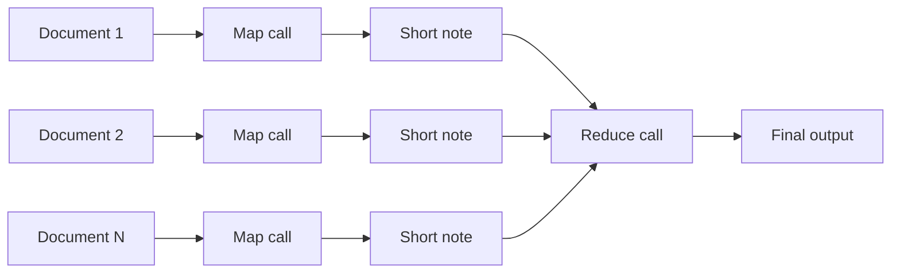

# Map-reduce in an agent skill

Sooner or later, a useful agent skill hits the same wall. It is asked to read the meeting notes of a quarter, the tickets of a release, or every page of a policy folder, and the input no longer fits in one context window. Even before the hard limit, quality slips as the window fills: details from the middle of the pile get lost, and the answer leans on whatever came first or last. The usual workarounds each give something up. A bigger model costs more per token. Truncation drops information on purpose. Retrieval reads a sample, which is fine for a question and wrong for a digest that must cover everything. We wondered if there was a more boring path.

There is an old one. Do not ask one LLM call to read everything. Give each document its own call, with a fresh context window and a small, bounded result. Then give the small results to one last call that writes the final answer. This is map-reduce, applied inside a skill. We have run it in production for a while, and this post packages it as a small skill you can copy: one Python script of about three hundred lines, two prompts, and a table of environment variables.

## Map, then reduce

The map stage turns each input into a short note: at most ten bullet points, a few hundred tokens. Each call sees exactly one document, so its context is never crowded, and a cheap, fast model is enough. The reduce stage reads all the notes at once. Because each note is small, a hundred documents become a reduce input of a few tens of thousands of tokens, which a stronger model handles comfortably.



The shape has two useful properties. The work per call stays constant however many documents there are, so quality does not degrade with the size of the pile. And the map calls do not depend on each other, so they can all run at the same time.

## The code, in three pieces

Everything that talks to the model goes through one function. It wraps the Bedrock [Converse API](https://docs.aws.amazon.com/bedrock/latest/userguide/conversation-inference.html), passes the token cap, and reports whether the model stopped because it hit that cap. Having a single seam is what makes the rest testable: an offline stub with the same signature replaces it in `--dry-run` mode.

<<< @/../skills/map-reduce/scripts/map_reduce.py#invoke{python}

The map stage submits one call per file to a thread pool. Each call clips its input to a character cap and gets its own token cap on the output. A failed call is recorded and does not stop the others. Results are sorted by source at the end, because completion order varies from run to run and the reduce should not.

<<< @/../skills/map-reduce/scripts/map_reduce.py#map{python}

The reduce stage is one call. It concatenates the notes under a `## source:` heading each, so the final output can cite where every finding came from.

<<< @/../skills/map-reduce/scripts/map_reduce.py#reduce{python}

The prompts live next to the script, in `prompts/map.md` and `prompts/reduce.md`. They are the part you are expected to change: what the map extracts, and what the reduce writes. The defaults produce a cited brief with an "open questions" section, which is a reasonable starting point for notes and reports.

## Threads, not processes

The map stage uses `concurrent.futures.ThreadPoolExecutor` from the standard library. An LLM call spends almost all its time waiting on the network, so the Python global interpreter lock is not the bottleneck, and threads are enough. They also share one `bedrock-runtime` client, which is thread-safe and keeps a connection pool sized to the worker count, with adaptive retries for throttling. Processes would add pickling and, on macOS, a slow `spawn` start-up for no gain. They are worth it only when the map stage itself does heavy local work, such as parsing large PDFs before the call.

## One command, no environment to manage

The script declares its own dependencies at the top, using inline script metadata ([PEP 723](https://peps.python.org/pep-0723/)):

```python
# /// script
# requires-python = ">=3.12"
# dependencies = ["boto3"]
# ///
```

With that header, `uv run` builds a cached, isolated environment on first use and reuses it afterwards. There is no virtual environment to create and no requirements file to install. `uvx` would not do here: it runs commands from published packages, not a local script file.

```shell
$ uv run skills/map-reduce/scripts/map_reduce.py --dry-run notes/
$ uv run skills/map-reduce/scripts/map_reduce.py notes/ --output brief.md
```

The first command runs the whole pipeline offline, with a deterministic stub instead of Bedrock: no credentials, no cost. It is how the repository checks the skill on every change, with `make skills-check`. The second runs for real, with the default AWS credentials, and prints a short summary on stderr: inputs mapped, inputs clipped, results that hit the token cap, tokens per stage, an estimated cost, and the elapsed time.

## Configuration lives in the skill

An agent reading the skill needs to know which knobs exist without reading the code. So every setting is an environment variable with a default, and the table lives in the skill's own `SKILL.md`:

| Variable | Default | Purpose |
| --- | --- | --- |
| `MAP_REDUCE_MAP_MODEL` | `eu.anthropic.claude-haiku-4-5-20251001-v1:0` | Map model, one call per input (cheap tier) |
| `MAP_REDUCE_REDUCE_MODEL` | `eu.anthropic.claude-sonnet-4-5-20250929-v1:0` | Reduce model, one call (stronger tier) |
| `MAP_REDUCE_REGION` | `eu-west-3` | AWS region of the Bedrock client |
| `MAP_REDUCE_WORKERS` | `8` | Concurrent map calls |
| `MAP_REDUCE_MAX_INPUT_CHARS` | `24000` | Characters of each input sent to the map call |
| `MAP_REDUCE_MAP_MAX_TOKENS` | `1024` | Token cap on each map result |
| `MAP_REDUCE_REDUCE_MAX_TOKENS` | `4096` | Token cap on the final output |
| `MAP_REDUCE_GLOB` | `**/*.md` | File pattern when the target is a folder |
| `MAP_REDUCE_MAP_PROMPT` | `prompts/map.md` | System prompt for the map stage |
| `MAP_REDUCE_REDUCE_PROMPT` | `prompts/reduce.md` | System prompt for the reduce stage |
| `MAP_REDUCE_BACKEND` | `bedrock` | `bedrock`, or `echo` for the offline stub |

The defaults pair a cheap model for the many map calls with a stronger one for the single reduce call, which is where most of the reasoning happens. The script never holds credentials; it uses whatever the default AWS credential chain provides.

The script reads its settings in one place, so the table and the code are easy to compare:

<<< @/../skills/map-reduce/scripts/map_reduce.py#config{python}

## Where it fits, and where it does not

This is a scoped recipe. It fits when the inputs are many independent files, when each one can be understood on its own, and when a short note per file carries enough for the final answer: digests of notes, release summaries, reviews of a folder of reports, extraction of decisions or risks across a corpus.

It does not fit every task, and naming the limits is part of the recipe:

- __Cross-document reasoning.__ The map stage sees one file at a time. Comparing two contracts clause by clause needs both in the same context, at full detail.
- __Ordering.__ Map calls run concurrently and see no neighbours. A story told across chapters, or a log where each entry depends on the previous one, loses its thread.
- __The cost of N calls.__ A hundred documents mean a hundred and one calls. On a cheap map model that is usually a small amount, but it is never free, and for a handful of files that fit in one window, one call is cheaper and simpler.
- __A reduce that overflows.__ If the notes together exceed the reduce model's window, tighten the map prompt or reduce in two levels.

## Where it comes from

The pattern is not new to us. It started in `update-memory`, a skill we use to refresh a project's shared memory from more than a thousand documents, issues, and notes. There, a swarm of cheap map calls digests each document, and further calls turn the digests into memory pages. That script grew to nearly a thousand lines, tied to its own facets and caching. The skill in this post keeps the proven parts (inline dependencies, one shared client, one call seam, bounded results, environment-variable configuration, a run summary with cost and time) and drops everything specific to memory. It is generic, and small enough to read in one sitting.

## What to take away

When a skill must read more than one context window holds, you do not need a bigger window. Give each document its own small call, keep each result small, and let one last call do the synthesis. The [map-reduce skill](https://github.com/bernard357/boringsteps/tree/main/skills/map-reduce) is in the repository of this blog, with its prompts and a few fixtures to try it offline. Copy the folder into your own skills, adjust the two prompts, and set the variables you need. Thank you in advance for your feedback.

## Further reading

- [The map-reduce skill on GitHub](https://github.com/bernard357/boringsteps/tree/main/skills/map-reduce)
- [Amazon Bedrock Converse API](https://docs.aws.amazon.com/bedrock/latest/userguide/conversation-inference.html)
- [PEP 723, inline script metadata](https://peps.python.org/pep-0723/) and [running scripts with uv](https://docs.astral.sh/uv/guides/scripts/)
- [concurrent.futures](https://docs.python.org/3/library/concurrent.futures.html) in the Python standard library
- [A frugal building block for semantic search](/duckdb-vectors), the previous post on this blog
